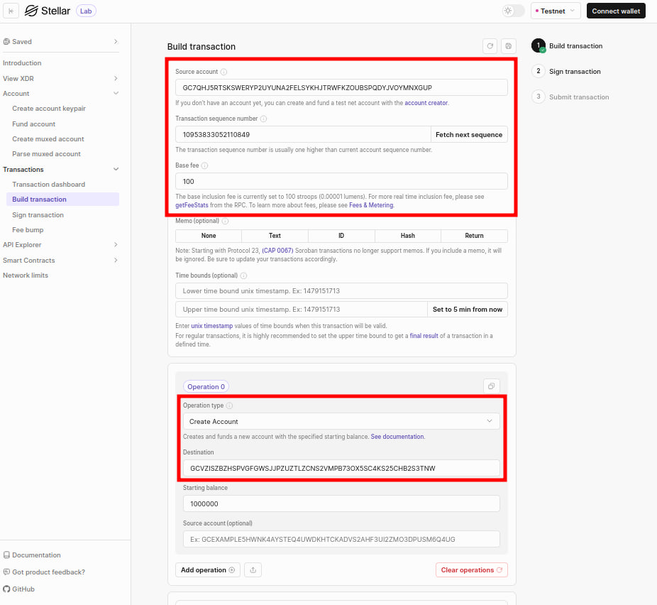
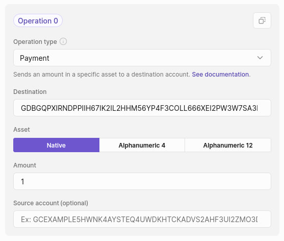
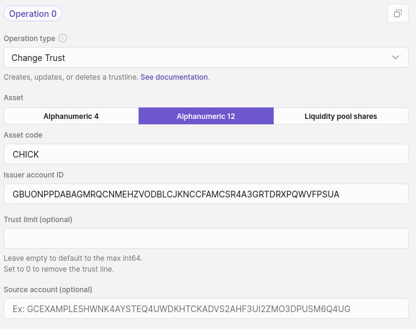
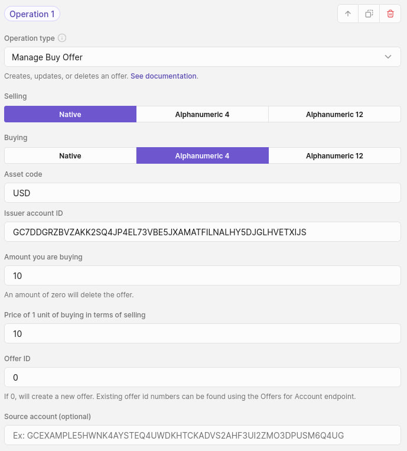
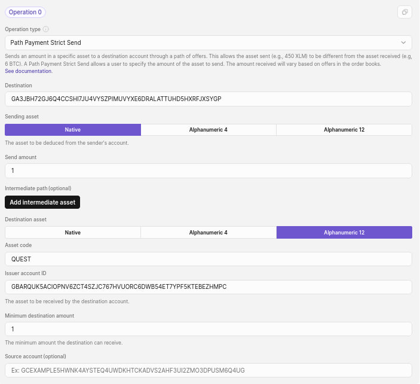

<table>
<tbody>
  <tr>
    <td><a href="https://albedo.link">Albedo Wallet</a></td>
    <td><a href="https://lab.stellar.org">Stellar Lab</a></td>
  </tr>
</tbody>
</table>

## Payment Operations

### Create Account

- **Source account**: The public key of the account that signs and pays for the transaction. Every transaction increases the source account's sequence number by one.
- **Destination**: Use the public key generated by `Account -> Create account keypair`.
- **Source account (optional)**: This allows to specify a different source account for each operation.
- **Starting balance**: It is denominated in XLM, so we need to choose an appropriate value.

### Payment

- **Destination**: It can be the public key of any account that has been created.
- **Amount**: The amount of XLM to send.

If an account is the issuer of an asset, they can use the `payment` operation to mint tokens.

#### References

- [Making a `payment` operation from the issuer account](https://developers.stellar.org/docs/build/guides/tokens/custom-sac-admin#making-a-payment-operation-from-the-issuer-account)

### Change Trust

Trustlines are an explicit opt-in for an account to hold a particular [stellar asset](https://developers.stellar.org/docs/tokens/anatomy-of-an-asset) that tracks liabilities, the balance of the asset, and can also limit the amount of an asset that an account can hold.

Assets can exist in three forms: alphanumeric 4, alphanumeric 12, and liquidity pool shares.

- Alphanumeric 4: Any characters from the set a-z, A-Z, 0-9 are allowed. The asset code is less than or equal to 4 characters and is case-sensitive.
- Alphanumeric 12: Any characters from the set a-z, A-Z, 0-9 are allowed. The asset code is between 5 and 12 characters and is case-sensitive.
- The pool share asset is defined by the liquidity pool identifier (PoolID), which in turn is defined by the two assets its reserves are composed of.

- **Asset code**: It can be anything within the alphanumeric 4 or 12 character bounds here.
- **Issuer account ID**: It is the public key of the account that is issuing the asset, which can be any account here.
- **Trust limit**: This field determines how much of the asset the source account can hold.

### Manage Offers

Manage offer operations allow an account to offer to buy or sell a specific amount of an asset at a specific exchange rate for a different asset. Stellar has three operations that manage these exchange offers:

- Manage buy offer
- Manage sell offer
- Create passive sell offer: this creates an offer to sell one asset for another without taking an existing reverse offer of equal price, which allows you to maintain an order book that both buys and sells an asset equally without the offers actually executing. It behaves exactly like a regular buy or sell offer once it's been created.

Every offer is technically both a buy and sell offer. The difference is primarily syntactical to make it easier to reason about the creation of offers.

Note that the source account must trust the issuer of the asset it's trying to buy.

#### References

- [Liquidity on Stellar: SDEX & Liquidity Pools](https://developers.stellar.org/docs/learn/fundamentals/liquidity-on-stellar-sdex-liquidity-pools#sdex)

### Path Payments

In a path payment, the asset received differs from the asset sent. Path payments cross through the SDEX and/or liquidity pools before arriving at the destination account.

For denoting a specific send amount, use the path payment strict send operation; otherwise, use the path payment strict receive operation to ensure that the destination account receives a specific amount of the destination asset.

The path payment strict send operation can ensure the amount of tokens received by setting a minimum destination amount, while the path payment strict receive operation can limit the amount of tokens sent by setting a maximum send amount.
